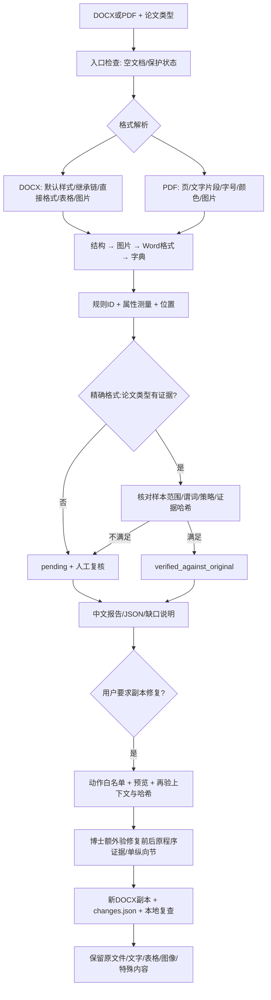

# 规则执行与证据链

v0.2.19 字号链：run读取parser+11d → 原生关联字符样式/直接格式 → 字号角色门与UTF16计数 → >10报告；段落后处理才启用后续run。单格表格与简单文本框的额外空边界保留顺序。76次原生执行/48输入核对，复杂结构不外推，副本修复不扩大。[说明](NATIVE_FONT_ACTIVATION_232.zh.md)

v0.2.18 段落链：00437374精确标题/第61段启用与非空文本门 → 负缩进float32或行距换算/Trunc/整数<180 → 00403318计数 → parser290/294/298 → 主槽4e/4f/50 → 68次原生同输入核对 → 版本/模式/源码/证据绑定与XML定位。首行槽51和复杂内容仍待恢复；长输入测试到1001段。[范围](NATIVE_PARAGRAPH_RULES_232.zh.md)

v0.2.17 字号链：OOXML属性/样式继承 → 004098f8字号半磅与角色标志 → 普通小字/tiny/大字分支 → 00402f08按UTF16计数（含空格） → 文本框此前字符数>100门 → 主槽0xb/0xd严格>10报告 → 29次同输入断点核对 → 版本/模式/配置/源码/证据绑定。tiny计数不冒充普通小字号诊断。[范围](NATIVE_FONT_RULES_232.zh.md)

v0.2.16 图形越界链：00438304 → 原生旋转分箱选择宽高 → 四个调整字段与基础宽+5/高−6比较 → 未越界严格门的否定（包含等值） → 00438a99图形分支 → parser0x200与主槽0x2a → 原文诊断 → 20个有效同输入核对 → 限定配置/源码/证据哈希。原生行为不等于实际旋转包围框。[范围](NATIVE_SHAPE_BOUNDS_232.zh.md)

v0.2.15 越界链：单节页面上下文 → 原生172/259基础值选择 → 宽基础值+5/高基础值−5严格比较 → 越界分支与槽0x2f → 最终报告 → 13个同输入审计 → 配置和哈希验证。尺寸越界会绕过小框分支；位置越界另行排除浮动文字。[范围](NATIVE_TEXTBOX_BOUNDS_232.zh.md)

v0.2.14 文本框扩展链：原始单位与样式层级 → 0041a204原生float32换算 → shape自适应标志及有效高度 → fc排除标志 → 宽/高实际发出分支 → 每框计数与最终>10门 → 32个原程序同输入审计 → 配置及哈希约束。px虽有一例和静态常数，仍缺边界矩阵，不提升验证。[详情](NATIVE_TEXTBOX_232.zh.md)

v0.2.13 绘图链：原始XML几何/环绕方式 → 原生float32尺寸与面积/独立计数槽 → 报告阈值与分支 → 15个相同输入的四类诊断对照 → 精确232/docx:phd配置及证据/实现哈希 → XML/文本框定位。未知环绕不把不可测当作命中；普通小字不替代小文本框计数。[范围](NATIVE_DRAWINGS_232.zh.md)

v0.2.12 图片字节链：引用绘图 → ZIP条目查找 → 本地头0x16字段 → unsigned严格大于30000000 → 对应图片上下文计数 → 文案40Mb → 同输入独立引擎核对 → 版本/配置/源码/证据哈希 → 逐图源定位。flags8本地字段0不会被中央目录实际大小替换；误报与漏报反例均保留。[证据范围](NATIVE_IMAGE_BYTES_232.zh.md)

v0.2.11：业务函数/数据槽位地图 → 原始图像维度 → 实际乘积与比较 → 输出标志/计数 → 诊断 → 相同输入本地差异 → `verification_by_build`精确配置及源码/证据哈希校验。首项232独立判据为博士普通RGB PNG像素面积，DOCX/PDF各有正例、负例和等值边界；旧230证据不会跨版本提升。图片单位定向转换修正和PDF资源别名去重均保留前后证据。[细节](NATIVE_IMAGE_RULE_232.zh.md)

v0.2.10 在原生对照链中增加精确模式选择与回读、实际内部模式码 master=1/phd=5、48/0选择下限与900分母、DOCX/PDF各自加载器及完整返回校验。任一错配拒绝成功。12个合成输入的原生记录与独立复核在 [模式审计](../evidence/business-map-232/native-modes-audit-r1/audit.json)。这条链验证原生包装器运行，不替代重建规则的逐项等价验证，也不开放博士/PDF修复。图片单位残余乱码作为已知差异保留。

v0.2.9 增加独立的原生对照路径：用户提供哈希匹配的 TestVkr232 → 私有输入副本 → 四份资源的八次 CP1251 定向转换 → 已初始化主线程的共享文件检查入口 → 实际分支/返回记录 → 完整原文诊断 JSON → 同输入差异复核。这些结果标记为带干预的原生参考，不自动改变重建引擎的验证状态、学校适用性或副本修改资格。参见 [原生 CLI](NATIVE_REFERENCE_CLI.zh.md)。

v0.2.8：新增逐项源事实复核和特殊角色分流；build232只独立开放硕士普通正文字号改14pt这一修复上下文。检测验证状态不因此全局升级。执行顺序：查询精确能力 → 预览 → 输入hash/计划ID/实现和证据hash一致 → 新副本与修改日志 → 232本地重查。CLI Word渲染保护对照与原程序结果均留证。[范围](BUILD232_REPAIR.zh.md)

v0.2.7追加：候选检测 → 源位置与属性 → 原程序版本/上下文证据 → `action_eligibility`（模式、参考适用性、内容角色）→ 条款/页面复核 → 独立修复验证 → 预览哈希与计划ID → 新副本与修改日志。候选数量减少不等于准确率提高的量化证明；build232修复门仍关闭。参见[后台CLI](AGENT_CLI.zh.md)和[伪源码说明](RECONSTRUCTED_ALGORITHM.zh.md)。

当前注册表包含39个规则ID；build232有19个独立格式/论文类型验证上下文，均受数据配置和哈希校验约束。数量由发布冻结脚本读取注册表计算。此统计不代表每项规则适用于所有格式、所有论文或所有内容结构。

## 规则来源与提高验证状态的条件

1. 原程序资源、字串、常量和恢复伪代码只产生候选规则；静态发现本身不构成动态等价证据。
2. 冻结合成输入并记录SHA256，在指定原程序build与论文类型下实际运行，保存完整文本和截图。
3. 正反对照及边界样本与本地谓词比较，通过后绑定verification_by_context[format:work_type]。
4. 输出时同时检查证据哈希、运行策略、内容配置与特定谓词支持标志。不满足条件即降为pending。
5. 聚合verified_formats / verified_work_types只是展示字段，禁止做笛卡尔积推断；修复还需要动作白名单，博士模式另验修复前后证据。

权威数据：[注册表](../scripts/testvkr-service/rules/rules_verified.json)；入口：[check_document.py](../scripts/check_document.py)；修复：[repair_document.py](../scripts/repair_document.py)；MCP：[server.py](../mcp/server.py)。

## 已有原程序证据的规则上下文

下面只列存在证据绑定的上下文。每条的有限样本范围、阈值和证据哈希以注册表对应context为准；“已验证”不是整篇论文认证。

| 规则ID | 独立验证上下文 | 主要证据 |
|---|---|---|
| `Word.FontSizeTooSmall` | `docx:bachelor`、`docx:master`、`docx:phd`、`pdf:phd` | [dynamic-master](../evidence/dynamic-master/comparison.json)、[dynamic-pairs](../evidence/dynamic-pairs/comparison.json)、[format-expansion](../evidence/format-expansion/comparison.json)、[multipage-phd-repair](../evidence/multipage-phd-repair/comparison.json) |
| `Word.PageSizeNotA4` | `docx:bachelor`、`docx:master`、`docx:phd`、`pdf:phd` | [dynamic-master](../evidence/dynamic-master/comparison.json)、[dynamic-pairs](../evidence/dynamic-pairs/comparison.json)、[format-expansion](../evidence/format-expansion/comparison.json)、[multipage-phd-repair](../evidence/multipage-phd-repair/comparison.json) |
| `Word.LeftMarginInvalid` | `docx:phd` | [format-expansion](../evidence/format-expansion/comparison.json) |
| `Word.RightMarginInvalid` | `docx:phd` | [format-expansion](../evidence/format-expansion/comparison.json) |
| `Word.TopMarginInvalid` | `docx:phd` | [format-expansion](../evidence/format-expansion/comparison.json) |
| `Word.BottomMarginInvalid` | `docx:phd` | [format-expansion](../evidence/format-expansion/comparison.json) |
| `Pic.PixelSizeTooLarge` | `docx:bachelor`、`docx:phd`、`pdf:phd` | [dynamic-pairs](../evidence/dynamic-pairs/comparison.json)、[format-expansion](../evidence/format-expansion/comparison.json)、[multipage-phd-repair](../evidence/multipage-phd-repair/comparison.json) |
| `Word.FontSizeTooLarge` | `docx:bachelor`、`docx:master`、`docx:phd` | [dynamic-master](../evidence/dynamic-master/comparison.json)、[dynamic-pairs](../evidence/dynamic-pairs/comparison.json)、[multipage-phd-repair](../evidence/multipage-phd-repair/comparison.json) |
| `Word.TextColorNotBlack` | `docx:bachelor`、`docx:master`、`docx:phd`、`pdf:phd` | [dynamic-master](../evidence/dynamic-master/comparison.json)、[dynamic-pairs](../evidence/dynamic-pairs/comparison.json)、[format-expansion](../evidence/format-expansion/comparison.json)、[multipage-phd-repair](../evidence/multipage-phd-repair/comparison.json) |
| `Graduate.UniversityNameInvalid` | `docx:master`、`docx:phd` | [graduate-structure](../evidence/graduate-structure/comparison.json) |
| `Graduate.TitlePageMismatch` | `docx:master`、`docx:phd` | [graduate-structure](../evidence/graduate-structure/comparison.json) |
| `Graduate.WorkNameInvalid` | `docx:phd` | [graduate-structure](../evidence/graduate-structure/comparison.json) |
| `Graduate.RequiredHeadingsMissing` | `docx:master`、`docx:phd` | [graduate-structure](../evidence/graduate-structure/comparison.json) |
| `Graduate.TocEmpty` | `docx:master`、`docx:phd` | [graduate-structure](../evidence/graduate-structure/comparison.json) |
| `Graduate.TocSmall` | `docx:master` | [graduate-structure](../evidence/graduate-structure/comparison.json) |
| `Graduate.AbstractTooShort` | `docx:master` | [graduate-structure](../evidence/graduate-structure/comparison.json) |
| `Graduate.ThesisSizeTooSmall` | `docx:master` | [graduate-structure](../evidence/graduate-structure/comparison.json) |
| `Struct.RequiredHeadingsMissing` | `pdf:phd` | [multipage-phd-repair](../evidence/multipage-phd-repair/comparison.json) |

## 主要阈值与不等价边界

- DOCX字号异常界限：小于8磅、超过18磅，累计违规字符超过10；不是正文推荐字号。博士PDF已测18.5/19/24/36/72磅均无大字号提示，不能套用DOCX上限。
- 原生图片像素面积上限：16000000；不是旧540像素宽度猜测。40Mb图片诊断的存储/解码量语义未独立验证，保持人工复核。
- 博士DOCX边距：左/右/上/下25/10/20/20毫米，容差±0.2毫米；左允许1406–1428 twips，相邻1405、1429失败。仅所测单节普通文本配置有边距证明，不自动修改边距。
- 硕士篇幅：48折算页、每页900个去首尾空白UTF-16单位；43199/43200和附录A目录页码47/48有动态边界对照。不是Word实际分页，带图表补偿未验证。
- 博士build-230分支不选择数值篇幅下限，旧100000字符猜测已停用；不代表学校没有篇幅要求。
- 硕士目录识别条目：小于5为空，5–10少，11的对照通过。摘要单段与三实质段对照已测；350俄语字符精确边界仅静态，不当作动态边界验证。

## 自动修复链

支持本科/硕士DOCX与单节纵向博士DOCX：A4、异常正文大小、非黑文字。字号目标来自用户或已知Normal样式。每次创建唯一新副本和changes.json，记录源/输出哈希、位置、原属性、修改后属性、跳过原因与本地复查。博士模式额外要求repair_evidence_ref哈希完整。
表格文字、图片、域、公式、超链接、修订内容、文本框、内容控件、页眉页脚保持原样。PDF、博士边距、行距、缩进和结构不自动修复；不承诺修改任意论文后均通过原程序。

## 当前PDF缺口

图表格式对照覆盖博士模式1–3页、无旋转、嵌入Times New Roman+ToUnicode、每页最多一张PNG。摘要与博士目录标题缺失另有13/14页文字结构对照，不据此扩大图表格式证明到任意页数。
PDF几何边距、页边文字、页码/页眉页脚位置、目录页码与正文对应、封面及参考文献完整性尚未复制。报告保留native_comparison_limits；本地零诊断不代表原程序通过。

完整结果：[本轮验收](../evidence/multipage-phd-repair/REPORT.zh.md)、[0.2.3验收](../evidence/format-expansion/REPORT.zh.md)、[Skill](../skills/bmstu-thesis-checker/SKILL.md)。

## 0.2.5 学校与案例证据分支

源文件字节哈希 → 模式/文档类型 → 解析与源坐标 → 原程序异常规则（原冻结上下文）＋独立学校参考规则 → 候选问题与人工判定 → 预览计划/哈希 → 受限副本修复 → 本地及排版QA/原程序复测。

Template.* 始终独立于 native verification；学位论文不继承NKR证据。真实论文不预设合格。原程序采集只有经过输入/模式/build/输出哈希校验才进入对照，未采集保留pending。案例内容和哈希不进入公共证据；公开的本地回归不证明真实论文原程序通过。

## 0.2.6 版本隔离与交叉对照

程序build+SHA256 → 同字节案例+固定模式 → 原诊断/UIA/截图哈希 → 本地报告选定版本 → 每条诊断/候选的类别关系 → 源属性/学校条款/页面人工判定。232四字号控制样本独立保存；不把230证据跨版本转移。真实案例不作标准答案，也不自动升级规则状态。
